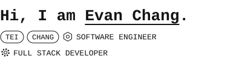

<a href="https://www.linkedin.com/in/evan-chang1/"><picture><source media="(prefers-color-scheme: dark)" srcset="assets/linkedin-nav-dark.svg"></picture></a>&nbsp;&nbsp;<a href="https://evch1204.github.io"><picture><source media="(prefers-color-scheme: dark)" srcset="assets/about-dark.svg"></picture></a>

 

<a href="https://evch1204.github.io"><picture><source media="(prefers-color-scheme: dark)" srcset="assets/hero-dark.svg"></picture></a>

 

Software engineer building full-stack web apps and AI developer tools. Santa Clara University '25.

 

### Works

[Doodle Life](https://github.com/evch1204/Doodle-Life) &nbsp; A walkable 3D sketchbook of real cities, drawn in ink with three.js.

[notchcode](https://github.com/evch1204/notchcode) &nbsp; The MacBook notch as a companion for Claude Code.

[GLC, taken apart](https://github.com/evch1204/glc-anatomy) &nbsp; An interactive isometric model of a car that comes apart.

[runningmap](https://runningmap.app.space) &nbsp; Sketch a running route on the map and get the distance back.

[drawspace](https://drawspace.app.space) &nbsp; A sketching canvas in the browser. No install, no account.

[bookwithme](https://bookwithme.app.space) &nbsp; Share a link and let people pick a time, without the email thread.

[docs](https://docs.app.space) &nbsp; A fast, lightweight document editor.

 

### Stack

<a href="#stack"><picture><source media="(prefers-color-scheme: dark)" srcset="assets/stack/claude-dark.svg"></picture></a>&nbsp;&nbsp;&nbsp;<a href="#stack"><picture><source media="(prefers-color-scheme: dark)" srcset="assets/stack/chatgpt-dark.svg"></picture></a>&nbsp;&nbsp;&nbsp;<a href="#stack"><picture><source media="(prefers-color-scheme: dark)" srcset="assets/stack/cursor-dark.svg"></picture></a>

<a href="#stack"><picture><source media="(prefers-color-scheme: dark)" srcset="assets/stack/typescript-dark.svg"></picture></a>&nbsp;&nbsp;&nbsp;<a href="#stack"><picture><source media="(prefers-color-scheme: dark)" srcset="assets/stack/javascript-dark.svg"></picture></a>&nbsp;&nbsp;&nbsp;<a href="#stack"><picture><source media="(prefers-color-scheme: dark)" srcset="assets/stack/python-dark.svg"></picture></a>&nbsp;&nbsp;&nbsp;<a href="#stack"><picture><source media="(prefers-color-scheme: dark)" srcset="assets/stack/cplusplus-dark.svg"></picture></a>&nbsp;&nbsp;&nbsp;<a href="#stack"><picture><source media="(prefers-color-scheme: dark)" srcset="assets/stack/swift-dark.svg"></picture></a>

<a href="#stack"><picture><source media="(prefers-color-scheme: dark)" srcset="assets/stack/react-dark.svg"></picture></a>&nbsp;&nbsp;&nbsp;<a href="#stack"><picture><source media="(prefers-color-scheme: dark)" srcset="assets/stack/nodejs-dark.svg"></picture></a>&nbsp;&nbsp;&nbsp;<a href="#stack"><picture><source media="(prefers-color-scheme: dark)" srcset="assets/stack/threejs-dark.svg"></picture></a>&nbsp;&nbsp;&nbsp;<a href="#stack"><picture><source media="(prefers-color-scheme: dark)" srcset="assets/stack/tailwind-dark.svg"></picture></a>&nbsp;&nbsp;&nbsp;<a href="#stack"><picture><source media="(prefers-color-scheme: dark)" srcset="assets/stack/pandas-dark.svg"></picture></a>&nbsp;&nbsp;&nbsp;<a href="#stack"><picture><source media="(prefers-color-scheme: dark)" srcset="assets/stack/scikitlearn-dark.svg"></picture></a>&nbsp;&nbsp;&nbsp;<a href="#stack"><picture><source media="(prefers-color-scheme: dark)" srcset="assets/stack/opencv-dark.svg"></picture></a>&nbsp;&nbsp;&nbsp;<a href="#stack"><picture><source media="(prefers-color-scheme: dark)" srcset="assets/stack/git-dark.svg"></picture></a>

 
 

<a href="https://evch1204.github.io"><picture><source media="(prefers-color-scheme: dark)" srcset="assets/location-dark.svg"></picture></a>&emsp;&emsp;<a href="mailto:changtei1204@gmail.com"><picture><source media="(prefers-color-scheme: dark)" srcset="assets/email-dark.svg"></picture></a>&emsp;&emsp;<a href="https://www.linkedin.com/in/evan-chang1/"><picture><source media="(prefers-color-scheme: dark)" srcset="assets/linkedin-dark.svg"></picture></a>&emsp;&emsp;<a href="https://evch1204.github.io/resume.pdf"><picture><source media="(prefers-color-scheme: dark)" srcset="assets/resume-dark.svg"></picture></a>

